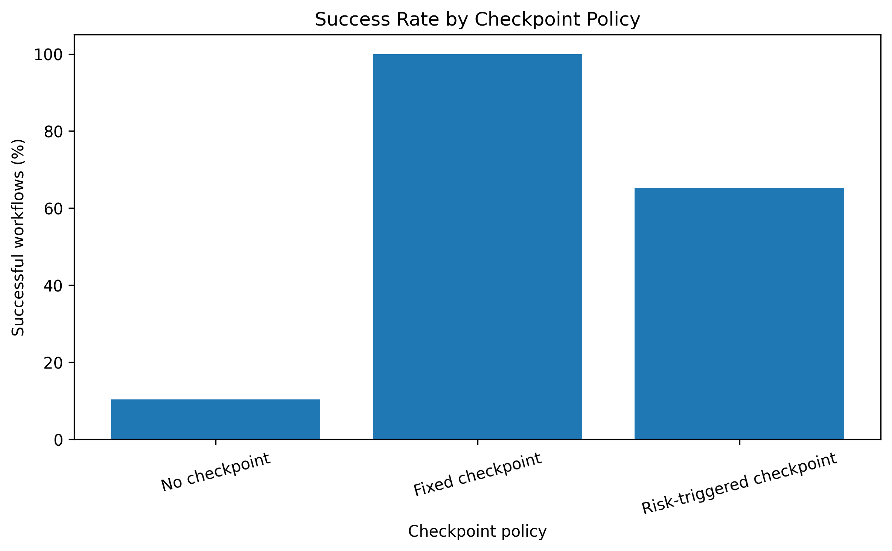

# Awesome Chained Tool-Calling Agents

A curated research repository on **failure modes in chained tool-calling agents operating without human checkpoints**. This repository brings together verified scholarly papers, datasets and benchmarks, tools and libraries, GitHub implementations, and learning resources related to LLM-based agents and autonomous tool use.

The goal is to provide a structured and reusable research resource for understanding how errors can propagate across chained tool calls and how human checkpoints, runtime monitoring, sandboxing, provenance tracking, capability restrictions, and adaptive oversight can improve agent reliability and security.

---

## Contents

* [Overview](#overview)
* [AI-Assisted Research Paper](#ai-assisted-research-paper)
* [Survey Papers](#survey-papers)
* [Foundational Papers](#foundational-papers)
* [Recent Research](#recent-research)
* [Methods and Algorithms](#methods-and-algorithms)
* [Applications](#applications)
* [Evaluation and Benchmarks](#evaluation-and-benchmarks)
* [Datasets](#datasets)
* [Tools and Libraries](#tools-and-libraries)
* [GitHub Implementations](#github-implementations)
* [Tutorials and Learning Resources](#tutorials-and-learning-resources)
* [Citation Integrity Audit](#citation-integrity-audit)
* [License](#license)

---

## Overview

Large language models have evolved from systems that primarily generate natural-language responses into systems capable of interacting with external environments. Tool-augmented agents can retrieve information, execute calculations, manipulate files, browse websites, call APIs, write and execute code, and perform multi-step tasks. Frameworks such as ReAct and Toolformer established important foundations for combining language-model reasoning with external actions.

A major reliability challenge occurs when an agent performs multiple tool calls in sequence. In a chained workflow, the output of one tool can become the input to another tool, creating a dependency between successive actions. If an early action is incorrect or its output is misinterpreted, later actions may operate on a corrupted state or an incorrect assumption.

The main failure modes considered in this research include **planning and decomposition failure, tool-selection failure, parameter and schema errors, error propagation, misinterpretation of tool outputs, state-tracking and context drift, prompt injection, privilege and capability escalation, irreversible actions, and recovery failure**.

The problem becomes more serious when chained execution occurs without human checkpoints. A human checkpoint can review an important intermediate result, resolve ambiguity, or approve a high-impact action before execution continues. Without such a checkpoint, an uncertain model-generated assumption can become the basis for subsequent actions.

This repository therefore focuses on the intersection of **agent reliability, tool use, security, evaluation, and human oversight**. Current research suggests that safe autonomous tool use requires more than successful final answers; systems should also know when to verify an output, recover from failure, request human review, or stop execution.

---

## AI-Assisted Research Paper

### Failure Modes in Chained Tool-Calling Agents Operating Without Human Checkpoints

**Abstract:**
This research examines the major failure modes associated with autonomous chains of tool calls when intermediate human validation is absent. The study focuses on error propagation, incorrect tool selection, parameter and schema errors, stale or misleading tool outputs, planning failures, state inconsistency, prompt injection, privilege escalation, irreversible actions, and inadequate recovery.

The research argues that chained execution changes the risk profile of an agent because downstream actions may treat an earlier model-generated assumption as an established fact. Human checkpoints can function as control boundaries that interrupt error propagation and prevent uncertain plans from becoming irreversible actions. The research also discusses structured tool interfaces, sandboxing, runtime monitoring, adversarial evaluation, provenance tracking, capability restrictions, and adaptive human oversight as potential approaches to improving agent safety and reliability.

**Paper:**
[View AI-Assisted Research Paper](paper/AI_Assisted_Research_Paper.pdf)

---

## Survey Papers

Survey papers provide broader coverage of tool learning and LLM-agent evaluation.

### Tool Learning with Large Language Models: A Survey

Qu et al. organize tool learning into major stages including task planning, tool selection, tool calling, and response generation. This framework is useful for identifying where failures can occur in a chained tool-calling pipeline.

[Paper / DOI](https://doi.org/10.1007/s11704-024-40678-2)

### Survey on Evaluation of LLM-based Agents

This survey examines approaches for evaluating LLM-based agents and highlights the importance of evaluating agent behavior beyond simple final-task success.

[Paper](https://arxiv.org/abs/2503.16416)

**More survey literature:**
See [`references/references.md`](references/references.md).

---

## Foundational Papers

### ReAct: Synergizing Reasoning and Acting in Language Models

**Yao et al., 2023 — ICLR 2023**

ReAct introduced an approach in which reasoning and acting are interleaved, allowing observations from external environments to influence subsequent actions. It provides an important foundation for understanding tool-using agents.

[Paper](https://arxiv.org/abs/2210.03629)

### Toolformer: Language Models Can Teach Themselves to Use Tools

**Schick et al., 2023 — NeurIPS 2023**

Toolformer investigates how language models can learn when and how to invoke external APIs and incorporate their results into subsequent generation.

[Paper](https://arxiv.org/abs/2302.04761)

### Gorilla: Large Language Model Connected with Massive APIs

**Patil et al., 2023**

Gorilla investigates reliable API invocation and addresses challenges related to API selection and argument generation.

[Paper](https://arxiv.org/abs/2305.15334)

### API-Bank: A Comprehensive Benchmark for Tool-Augmented LLMs

**Li et al., 2023 — EMNLP 2023**

API-Bank evaluates planning, API retrieval, and API calling, making it useful for studying different competencies involved in tool use.

[Paper / DOI](https://doi.org/10.18653/v1/2023.emnlp-main.187)

---

## Recent Research

Recent research increasingly focuses on the security, evaluation, and reliability of autonomous agents.

### InjecAgent

**Zhan et al., 2024**

Studies indirect prompt injection in tool-integrated LLM agents and demonstrates how external content can influence agent behavior.

[Paper / DOI](https://doi.org/10.18653/v1/2024.findings-acl.624)

### AgentDojo

**Debenedetti et al., 2024**

Provides a dynamic environment for evaluating prompt-injection attacks and defenses against LLM agents.

[Paper](https://arxiv.org/abs/2406.13352)

### Agent Security Bench

**Zhang et al., 2025**

Provides a broader evaluation of attacks and defenses for LLM-based agents.

[Paper](https://arxiv.org/abs/2410.02644)

### AgentSecBench

**Alpay & Alpay, 2026**

Focuses on prompt injection, privacy leakage, and tool-use integrity in LLM agents.

[Paper](https://arxiv.org/abs/2605.26269)

For additional recent research, see [`references/references.md`](references/references.md).

---

## Methods and Algorithms

The research area can be understood through several important methodological components.

### 1. Chained Tool Execution

A chained execution process can be represented conceptually as:

```text
Initial State
     ↓
Agent Action / Tool Call
     ↓
Tool Output
     ↓
Next Agent Action
     ↓
Next Tool Output
     ↓
...
     ↓
Final Action
```

An early incorrect action can therefore affect multiple downstream operations.

### 2. Error Propagation

Under a simplified assumption where each tool call has probability `p` of being correct, the probability that all `n` calls are correct is:

```text
P(all correct) = p^n
```

For example:

```text
0.95^10 ≈ 0.599
```

This illustrates how reliability can decrease as the number of chained operations increases, although real-world failures are not necessarily independent.

### 3. Human Checkpoints

Human checkpoints can act as control barriers:

```text
Plan
  ↓
Tool 1
  ↓
[Human Review]
  ↓
Tool 2
  ↓
[Human Review]
  ↓
High-Impact Action
```

The research suggests that checkpoints should be **risk-adaptive** rather than necessarily occurring after every operation. Possible triggers include high uncertainty, sensitive data, unusual tool combinations, irreversible actions, privilege changes, conflicting tool outputs, and anomalous behavior.

### 4. Runtime Monitoring

Runtime monitoring can inspect tool calls before execution, compare proposed actions against policies, detect anomalous sequences, and prevent unauthorized operations.

### 5. Provenance-Aware State Management

Important intermediate values should retain information about their origin, query, time, and validation status. This can help identify stale or unverified assumptions before they enter later tool calls.

---

## Applications

Chained tool-calling agents can be applied in many environments, including:

* **Information retrieval** — retrieving information and processing it through multiple tools.
* **Software engineering** — searching code, modifying files, executing tests, and generating reports.
* **Data analysis** — retrieving datasets, processing information, calculating results, and generating reports.
* **Financial workflows** — retrieving and analyzing financial records.
* **Travel assistance** — searching, comparing, and booking travel-related services.
* **Communication systems** — retrieving information and generating or sending messages.
* **Enterprise workflows** — interacting with databases, APIs, documents, and business services.

These applications also demonstrate why tool chains require careful oversight. An agent may move from relatively reversible information retrieval to high-impact actions such as sending messages, changing permissions, transferring funds, or modifying infrastructure.

---

## Evaluation and Benchmarks

Evaluation is important because an agent can produce a successful final answer while making unsafe or incorrect intermediate decisions.

### API-Bank

Evaluates planning, API retrieval, and API calling.

[Paper](https://arxiv.org/abs/2304.08244)

### AgentBench

Evaluates LLM agents across multiple interactive environments and examines long-term reasoning, decision-making, and instruction following.

[Paper](https://arxiv.org/abs/2308.03688)

### AgentDojo

Evaluates agent utility and security in dynamic environments, including prompt-injection scenarios.

[Paper](https://arxiv.org/abs/2406.13352)

### Agent Security Bench

Evaluates attacks and defenses across multiple agent security scenarios.

[Paper](https://arxiv.org/abs/2410.02644)

For the complete benchmark and dataset collection, see [`datasets/datasets.md`](datasets/datasets.md).

---

## Datasets

The repository contains three major datasets/benchmark resources relevant to tool-using agents:

| Dataset / Benchmark | Main Focus                             |
| ------------------- | -------------------------------------- |
| **AgentDojo**       | Agent security and prompt injection    |
| **ToolBench**       | Tool learning and multi-tool execution |
| **API-Bank**        | Tool-augmented LLM evaluation          |

### AgentDojo

A dynamic environment for evaluating LLM agents and prompt-injection attacks.

[Dataset / Repository](https://github.com/ethz-spylab/agentdojo)

### ToolBench

A large-scale resource for training and evaluating LLMs on real-world APIs and tool-use scenarios.

[Dataset / Repository](https://github.com/OpenBMB/ToolBench)

### API-Bank

A benchmark for planning, API retrieval, and API calling.

[Paper](https://arxiv.org/abs/2304.08244)

See [`datasets/datasets.md`](datasets/datasets.md) for detailed descriptions and applications.

---

## Tools and Libraries

The following tools and frameworks are useful for constructing and evaluating LLM-based agent systems.

| Tool                  | Purpose                                  |
| --------------------- | ---------------------------------------- |
| **LangChain**         | LLM applications and tool integration    |
| **LangGraph**         | Stateful and graph-based agent workflows |
| **LlamaIndex**        | Data retrieval and agent applications    |
| **Microsoft AutoGen** | Multi-agent applications                 |
| **OpenAI Evals**      | AI model and system evaluation           |

### LangChain

Framework for building LLM applications and agents that interact with external tools and services.

[Official Website](https://www.langchain.com/)

### LangGraph

Framework for building stateful and multi-step agent workflows.

[Official Website](https://www.langchain.com/langgraph)

### LlamaIndex

Framework for connecting LLM applications with external data and retrieval systems.

[Official Website](https://www.llamaindex.ai/)

### Microsoft AutoGen

Framework for developing multi-agent applications and agent interactions.

[Official Website](https://microsoft.github.io/autogen/)

### OpenAI Evals

Framework for evaluating AI models and systems.

[GitHub Repository](https://github.com/openai/evals)

More information is available in [`tools/tools.md`](tools/tools.md).

---

## GitHub Implementations

The following open-source implementations are particularly relevant to this research.

### ReAct

Implementation of the reasoning-and-acting approach for language-model agents.

[GitHub Repository](https://github.com/ysymyth/ReAct)

### ToolBench / ToolLLM

Implementation and resources for large-scale tool learning and multi-tool use.

[GitHub Repository](https://github.com/OpenBMB/ToolBench)

### Gorilla

Implementation focused on connecting language models with large collections of APIs.

[GitHub Repository](https://github.com/ShishirPatil/gorilla)

### AgentDojo

Implementation of a dynamic environment for evaluating tool-using agents and prompt injection.

[GitHub Repository](https://github.com/ethz-spylab/agentdojo)

### Agent Security Bench

Implementation and evaluation framework for attacks and defenses against LLM-based agents.

[GitHub Repository](https://github.com/agiresearch/ASB)

See [`implementations/github-repositories.md`](implementations/github-repositories.md) for detailed descriptions and research relevance.

---

## Tutorials and Learning Resources

The following types of learning resources are useful for understanding this research area:

1. **ReAct research and implementation** — useful for understanding reasoning-and-acting agent architectures.
2. **ToolBench documentation** — useful for learning large-scale tool learning and API interaction.
3. **AgentDojo documentation** — useful for learning about prompt injection and agent security evaluation.
4. **LangChain documentation** — useful for learning tool integration and LLM application development.
5. **LangGraph documentation** — useful for learning stateful, graph-based agent workflows.

These resources can help researchers understand both the development and evaluation sides of tool-using agents.

---

## Citation Integrity Audit

The research references used in this repository were reviewed with the objective of checking citation accuracy and ensuring that scholarly resources genuinely exist.

The verification process considers:

* Correct paper title
* Correct authors
* Publication year
* Journal or conference
* DOI, where available
* Existence of the cited paper
* Whether the provided link corresponds to the cited paper

The assignment requires references to be independently verified rather than accepted solely because they were generated by an AI system.

The research paper also contains a dedicated reference list covering foundational tool-use research, agent benchmarks, security research, and recent work on agent safety.

[View Citation Integrity Audit](citation-audit/Citation_Integrity_Audit.pdf)

---

## Research Focus

The central research problem can be summarized as:

```text
LLM Agent
    ↓
Planning
    ↓
Tool Selection
    ↓
Parameter Generation
    ↓
Tool Execution
    ↓
Tool Output
    ↓
Interpretation
    ↓
Next Tool Call
    ↓
...
    ↓
High-Impact Action
```

Without appropriate validation, a failure at any earlier stage can become an assumption for a later stage.

Important failure modes include:

* Planning and decomposition failure
* Tool-selection failure
* Parameter and schema errors
* Error propagation
* Misinterpretation of tool outputs
* State-tracking and context drift
* Prompt injection
* Privilege and capability escalation
* Irreversible actions
* Recovery failure

These failure modes are the primary focus of the research paper and the curated resources in this repository.

---

## Future Research Directions

The research identifies several directions for improving autonomous tool-using agents:

### Chain-Level Reliability Metrics

Evaluation should consider the number of tool calls, retries, first point of failure, propagation length, recovery success, irreversible actions, policy violations, and human interventions.

### Provenance-Aware State Management

Agents should maintain explicit provenance for important intermediate values so that unverified assumptions can be detected before they affect later operations.

### Adaptive Checkpoint Placement

Human review can be triggered when the expected risk of autonomous continuation becomes greater than the cost of human intervention.

### Compositional Security Analysis

Security evaluation should examine combinations of tools and capabilities rather than considering each tool independently.

### Failure-Aware Agent Architectures

Future systems should explicitly represent intermediate results as verified, plausible but unverified, contradictory, stale, malformed, or unsafe to act upon.

---

## Citation and Reference Policy

This repository follows the academic-resource curation principles specified in the assignment:

* Scholarly resources should be verified before inclusion.
* References should not be fabricated.
* Paper links should point to DOI, publisher, arXiv, or another authoritative source where appropriate.
* Copyrighted research-paper PDFs should not be uploaded without permission.
* The repository should provide enough information for another researcher to understand why each resource is relevant.

---

## Repository Structure

```text
awesome-chained-tool-calling-agents/
│
├── README.md
│
├── paper/
│   └── AI_Assisted_Research_Paper.pdf
│
├── citation-audit/
│   └── Citation_Integrity_Audit.pdf
│
├── references/
│   └── references.md
│
├── datasets/
│   └── datasets.md
│
├── tools/
│   └── tools.md
│
├── implementations/
│   └── github-repositories.md
│
└── LICENSE
```

This structure follows the repository organization recommended in the assignment.

---
## Simulation Results

This project includes a preliminary simulation comparing three checkpoint policies in chained tool-calling workflows.

- **No checkpoint:** The workflow runs without checkpoint-based recovery.
- **Fixed checkpoint:** The workflow checks at predefined intervals.
- **Risk-triggered checkpoint:** The workflow checks when a simulated risk flag is triggered.

### Results and Visualization

The simulation results are available in [`checkpoint_comparison_v2.csv`](checkpoint_comparison_v2.csv).

The success-rate graph is shown below:



**Important limitation:** These results come from a simplified simulation and depend on the assumptions implemented in the code. They should not be interpreted as evidence of real-world agent performance.

---


## License

This repository contains original documentation and curated links to external research resources.

The repository's own original content is intended to be shared under the license specified in [`LICENSE`](LICENSE).

External papers, datasets, software, trademarks, and other resources remain subject to their respective authors' or organizations' licenses and terms of use.

---

## Acknowledgement

This repository was developed as part of the **AI Tools for Research — GitHub Research Curation and Documentation** activity. The purpose is to demonstrate the use of GitHub as a platform for organizing, documenting, verifying, and sharing a structured research resource.

---

## Repository Goal

> **Build, document, curate, verify, maintain, and share a structured research knowledge resource on safe and reliable chained tool-calling agents.**

The ultimate goal is to understand not only **how agents use tools**, but also **when they should verify a result, when they should recover, when human intervention is required, and when autonomous execution should stop**.
